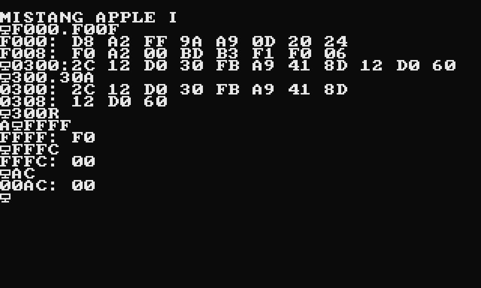

# MiSTang Apple I

An Apple I style computer for the Sipeed Tang Nano 20K, written from scratch: NMOS 6502 CPU (official opcodes, decimal mode, JMP-indirect page bug), 4 KiB RAM, a Woz-style monitor in ROM written for this project, a 40x24 text terminal on HDMI (960x576 over 720p timing) and keyboard input over the USB-UART (115200 baud).

## Verification
- CPU: 200/200 random-program seeds match an independent Python reference (`tools/ref6502.py`, `tools/difftest.py`), binary and decimal mode.
- System: monitor session driven through the UART receiver matches `tools/sysmodel.py` (`./test_sys.sh`); the video stage matches a reference text renderer.
- Board bitstream: builds, placed with seed 1, pixel clock 108 MHz at 74.25 needed.
- Board run: the bitstream runs on a real Tang Nano 20K (2026-11-04); the boot banner is on screen in an HDMI capture (below). Keyboard input on the board was not tested.

## Use
- Build: `TOOLS=/path/to/oss-cad-suite bash build.sh` -> `build/apple1_top/apple1_top.fs`
- Test: `./test_sys.sh`
- Type monitor commands over the UART (`F000.F00F` dumps, `0300:A9 41` stores, `300R` runs).
- Screenshot over UART: `python3 tools/capture.py /dev/cu.usbserial-XXXX out.png`

## Licence
MIT.
